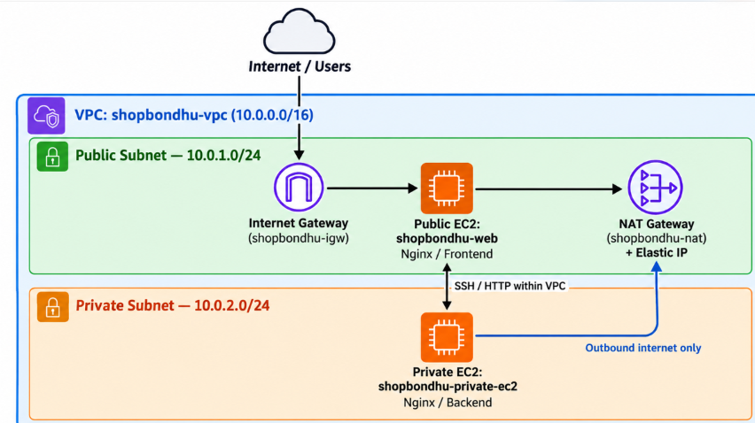
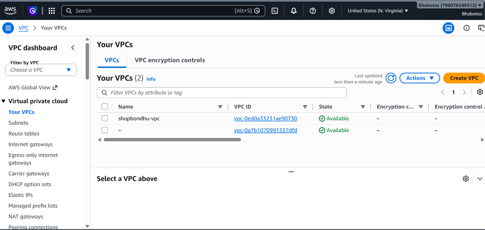
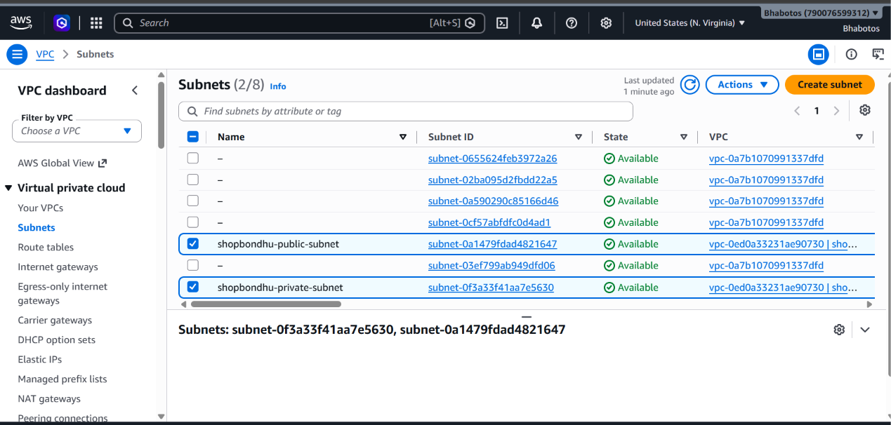
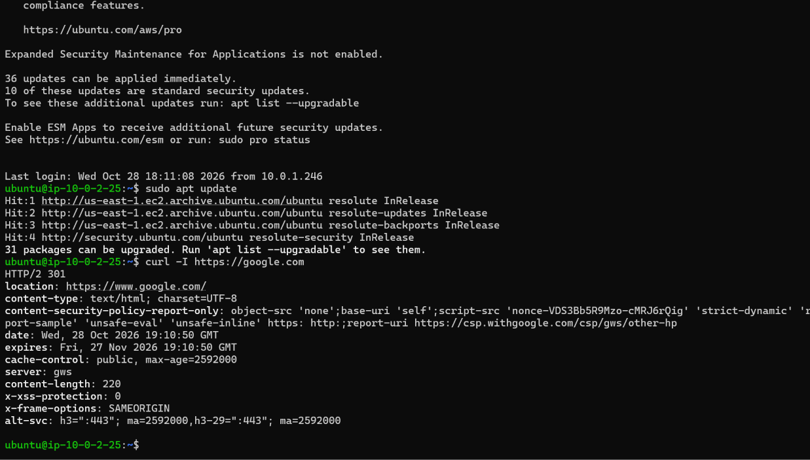

# ShopBondhu AWS Assignment

## 1. Project Title & Short Description

ShopBondhu is a small e-commerce startup requiring a publicly accessible landing page and a private backend server.

This project demonstrates how to build a custom AWS network using a VPC, public and private subnets, Internet Gateway, NAT Gateway, EC2 instances, security groups, and Nginx.

## 2. Architecture Diagram

## 3. Resources Created

| Resource | Name | CIDR / ID | Notes |
|---|---|---|---|
| VPC | shopbondhu-vpc | 10.0.0.0/16 | Custom VPC |
| Public Subnet | shopbondhu-public-subnet | 10.0.1.0/24 | Public EC2 |
| Private Subnet | shopbondhu-private-subnet | 10.0.2.0/24 | Private EC2 |
| Internet Gateway | shopbondhu-igw | — | Internet access for public subnet |
| NAT Gateway | shopbondhu-nat | — | Outbound access for private subnet |
| Public Route Table | shopbondhu-public-rt | — | Associated with public subnet |
| Private Route Table | shopbondhu-private-rt | — | Associated with private subnet |
| Public EC2 | shopbondhu-web | 10.0.1.246 | Public web server |
| Private EC2 | shopbondhu-private-ec2 | 10.0.2.25 | Private backend server |
## Screenshots

### 1. VPC Configuration

### 2. Public and Private Subnets

### 3. Route Tables

### 4. Internet Gateway

### 5. NAT Gateway

### 6. EC2 Instances

### 7. Nginx Website

### 8. Private EC2 SSH Connection

### 9. Private EC2 Nginx Test

## 4. Step-by-Step Setup

### Task 1: Create VPC
Created a custom VPC named `shopbondhu-vpc` with CIDR `10.0.0.0/16`.

### Task 2: Create Subnets
Created a public subnet `shopbondhu-public-subnet` and a private subnet `shopbondhu-private-subnet`.

### Task 3: Internet Gateway
Created and attached `shopbondhu-igw` to the VPC.

### Task 4: NAT Gateway
Created `shopbondhu-nat` in the public subnet and allocated an Elastic IP.

### Task 5: Route Tables
Configured the public route table to route internet traffic through the Internet Gateway and the private route table to route outbound internet traffic through the NAT Gateway.

### Task 6: Launch EC2 Instances
Launched the public web EC2 and private backend EC2 in their respective subnets.

### Task 7: Configure Security Groups
Configured security groups to allow the required SSH and HTTP access.

## 5. Nginx & Frontend Deployment

Nginx was installed and started on the server.

The landing page was deployed to Nginx's web root directory:

`/var/www/html`

The website was tested using the public IP address of the web server.

## 6. NAT Gateway Test

The private EC2 instance was tested for outbound internet connectivity through the NAT Gateway.

- `sudo apt update` — Successful
- `curl -I https://google.com` — Successful
- Private EC2 has no public IP address.
- Outbound internet access is provided through the NAT Gateway.

## 7. Troubleshooting Answers

### Problem A: Website does not open, but SSH works

Possible reasons:
1. Nginx is not running.
2. Security Group does not allow inbound HTTP port 80.
3. The public route table does not have a route to the Internet Gateway.

### Problem B: `sudo apt update` hangs on backend

Possible reasons:
1. NAT Gateway is not available or is in the wrong subnet.
2. The private route table does not have a default route to the NAT Gateway.
3. NAT Gateway Elastic IP or public subnet routing is not configured correctly.

## 8. Cleanup

After completing the assignment and capturing the required evidence, the NAT Gateway and its Elastic IP will be deleted to avoid unnecessary AWS charges.

Cleanup proof screenshots will be added here.

## 9. What I Learned

- How to create a custom VPC with public and private subnets.
- How Internet Gateway and NAT Gateway provide different types of internet access.
- How to configure route tables and security groups.
- How to deploy and test Nginx on EC2.
- How to connect to a private EC2 instance through a public EC2 instance.
